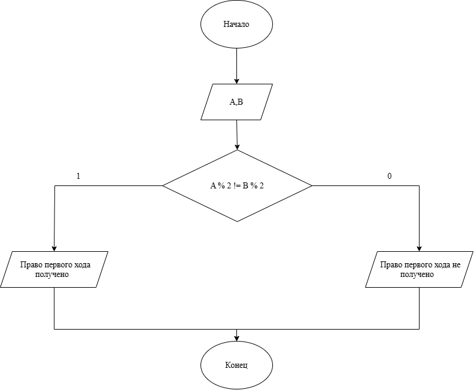

# Домашнее задание к работе номер 4
## Условие задачи
Двум командам (A и B) выпали номера. Право первого хода получает та команда, для которой выполняется условие: только один из выпавших номеров четный. Запишите условие для получения права первого хода.
## 1. Алгоритм и блок-схема
### Алгоритм:
1. Начало
2. Объявить переменные:
- **A** - первая команда.
- **B** - вторая команда.
3. Составить условие при помощи операторов if и else.
4. Конец.
### Блок-схема:

## 2. Реализация программы
```c
#define _CRT_SECURE_NO_WARNINGS
#include <stdio.h>
#include <locale.h>

void main() {
    setlocale(LC_ALL, "RUS");
    int A, B;
    printf("Номер команды A: ");
    scanf("%d", &A);

    printf("Номер команды B: ");
    scanf("%d", &B);

    int res = ((A % 2 == 0) ^ (B % 2 == 0));
    printf("Право первого хода получено (1 - да, 0 - нет): %d\n", res);
}
```
## 3. Результаты работы программы
Случай 1:
Номер команды A: 2
Номер команды B: 5
Право первого хода получено

Случай 2:
Номер команды A: 4
Номер команды B: 6
Право первого хода не получено

## 4. Информация о разработчике
Литуновский Максим Дмитриевич, бТИИ-261
